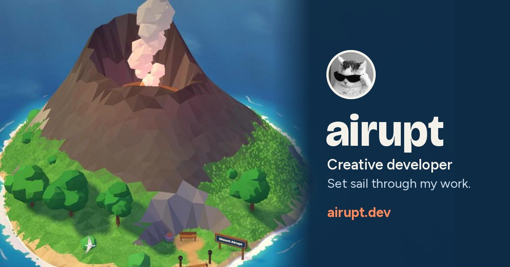

## Hi, I'm airupt 👋

I'm a creative developer, and I've been building things for screens for more than five years: interactive 3D on the web, websites and web apps, game servers, and the tools and automations that keep it all afloat.

- 🎮 These days I'm mostly deep in game projects, as a developer at [Reallife Roleplay](https://realliferoleplay.nl)
- ⛵ My portfolio is a little boat you can sail between islands: [airupt.dev](https://airupt.dev)
- 🤝 I'm open to freelance work and full-time roles
- 💬 The easiest way to reach me is on [X @airuptwastaken](https://x.com/airuptwastaken)

### What I like to build

- 🧊 **3D on the web:** worlds you can explore in the browser, with Three.js, GLSL shaders and real-time physics
- 🌐 **Websites and web apps:** front to back, with Vue, Nuxt, React, Next.js and Node.js
- 🕹️ **Game servers:** FiveM gameplay systems, in-game interfaces and the infrastructure behind them
- 🤖 **Tools and automation:** AI agents, Discord bots, n8n workflows and the glue in between

### Where I've worked

- **[Reallife Roleplay](https://realliferoleplay.nl)** · Developer · 2026–now 
  A Dutch GTA V roleplay server on FiveM. With the rest of the dev team I build gameplay systems, in-game interfaces, server infrastructure and the tools that keep it running.
- **[Quasar Store](https://quasar-store.com)** · Freelance developer · 2024–2026 
  In-game interfaces and gameplay scripts for their catalogue of premium FiveM scripts, used by more than 30,000 servers.

### Something I made

**[airupt.dev](https://airupt.dev)** is my portfolio, built from scratch: you steer a boat across a low-poly sea and each island opens a part of it. The islands are grown from noise in code, the boat rides the same waves the ocean shader draws, and if you wait for night, the lighthouse lights up and the wake starts to glow. The [source](https://github.com/airupt/airupt.dev) is open.

### Toolbox

Everything else I work with

 

- **Frontend:** Svelte, Astro, Angular, WebGPU, GSAP, Tailwind CSS, HTML & CSS, Web Audio, PWAs, Electron, React Native
- **Backend:** Python, PHP & Laravel, C# & .NET, PostgreSQL, MongoDB, Redis, REST & GraphQL APIs, Supabase, Firebase, WebSockets
- **Game servers:** QBCore, ESX, Qbox, txAdmin, Pterodactyl, performance profiling, anti-cheat
- **AI & automation:** LLM APIs (Claude, OpenAI), AI agents & MCP, AI coding tools, RAG & vector databases, prompt engineering, image & video generation, voice & speech AI, fine-tuning, computer vision, Discord bots, n8n & Zapier, web scraping
- **Tools:** Git & GitHub, GitHub Actions, Vercel & Netlify, Nginx, Linux servers, Vite

Fun fact: the smoking volcano on my site is called Mount Airupt. It's the "erupt" in airupt.
